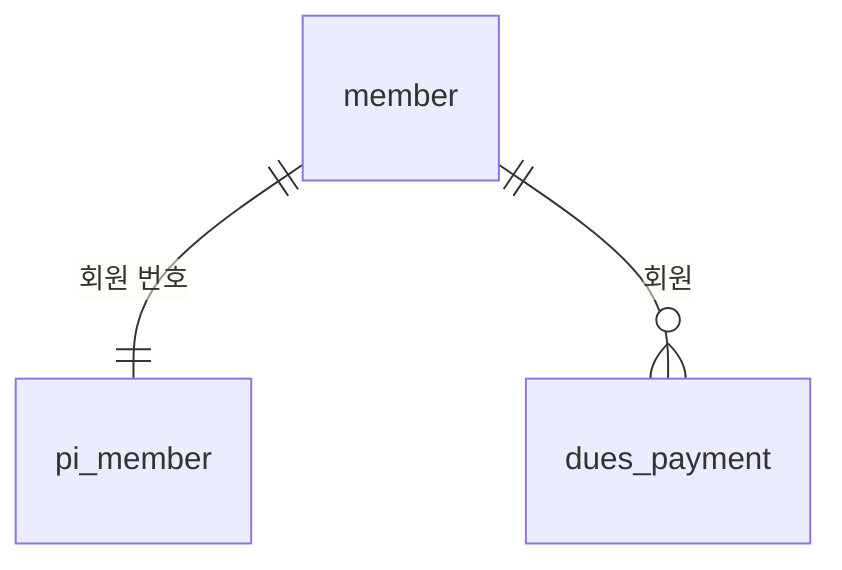

# 따라 하기 -- 동아리 회비 (데이터부터: dev-process-light + 짝 스킬 data-light)

저장할 데이터가 있는 사이트를 시작할 때 **dev-process-light 가 짝 스킬 data-light 로 데이터 설계를 넘겨주고, 다시 돌아오는 흐름**입니다.
0.9.0 kit(짝 data-light 0.3.0)을 빈 폴더에 설치하고 AI(Claude)가 규칙대로 실제로 수행했습니다. 명령과 그 출력, 기록의 시각은 실제이고,
**사용자 역할의 답은 예시**입니다 (그래서 몇 분 만에 끝났습니다). 샘플 값(이름·전화번호)도 만든 값입니다.
화면은 아직 없습니다 -- 네 단계 중 **1단계(데이터 설계)까지**입니다.

결과 파일: 기록 [`dev-notes/`](dev-notes/NOW.md) (데이터 기록 [`log/데이터/2026-10-15.md`](dev-notes/log/데이터/2026-10-15.md)) ·
데이터 설계 정본 [`data/model.light.json`](data/model.light.json) · 관계 그림 [`data/out/erd.md`](data/out/erd.md) ·
정의서 [`data/out/spec.md`](data/out/spec.md) · Supabase 용 SQL [`data/out/schema.sql`](data/out/schema.sql) ·
저장 목록 [`git-log.txt`](git-log.txt) · 기록 보기 페이지의 데이터 메뉴 [`portal-data.png`](portal-data.png)

---

## 0. 설치하고 시작 (`light-resume`)
```bash
bash ~/dev-process-light/install.sh club-dues
```
```
  [OK] 스킬 8개 -> .claude/skills
  [OK] 스킬 8개 -> .agents/skills
  [OK] 짝 스킬 data-light 0.3.0 (data-expert-framework-light e84d857) -- 저장할 데이터가 생기면 씁니다
```
> **나:** light-resume 으로 시작해 줘
>
> **AI:** (처음인 프로젝트 → git 시작, `.gitignore` 만들기) 무엇을 만드는 사이트인가요?
>
> **나:** 동아리 회비를 임원 셋(회장·총무·서기)이 같이 관리하는 사이트. 회원 명단, 회비 입력, 미납 보기. 각자 로그인해서 쓰고 Supabase 에 올릴 거야.

AI 는 답에서 알 수 있는 것을 `NOW.md` "이 프로젝트는" 아래 다섯 줄에 적습니다. **모르는 것은 따로 묻지 않습니다** --
필요해질 때 그 일을 하는 스킬이 한 번만 묻습니다. 이 다섯 줄은 light 스킬과 data-light 가 **같이 쓰는 답**입니다.
```
- 누가 쓰나: 몇 명이 같이 (임원 3명 -- 회장·총무·서기)
- 로그인: 있음 (임원마다 각자)
- 올리는 곳: Supabase
- 저장하는 데이터: (아직 모름)
- 개인정보: (아직 모름)
```
기록 보기 페이지는 1번(`dev-notes/portal.html`)으로 정하고, **첫 저장 전에** 한 번 만들어 `.gitignore` 에 들어간 줄까지
첫 저장에 넣습니다 → `준비: 작업 기록 시작`.

## 1. 큰 요청은 나누고, 데이터 설계를 1단계로 (`light-start`)
> **나:** 그럼 만들어 줘

표가 둘 이상 이어지고(회원 → 회비), 여럿이 로그인해서 쓰고, 이름·전화번호가 들어갑니다 -- `light-start` 의 "넘겨줄 때"에
세 가지나 해당하므로 데이터 설계가 1단계입니다.
```
### 작업: 동아리 회비 (1/4 데이터 설계)
- 목표: 무엇을 어떻게 저장할지 정하고 확인받는다 (화면은 다음 단계부터)
- 완료 기준:
  - [ ] 관계 그림(ERD)과 표 목록을 보고 사용자가 "맞다"고 했다
  - [ ] 이름·전화번호는 따로 보관하는 표(pi_)에 있다
  - [ ] 미납 보기·회비 합계를 확인하는 성공 기준이 샘플 데이터로 맞게 나온다
  - [ ] 같은 회원이 같은 달 회비를 두 번 넣으면 막힌다 (정본의 규칙으로)
  - [ ] 데이터 검사(verify)가 통과하고, 일부러 규칙을 빼도(--mutate) 잡아낸다
  - [ ] 정의서(data/out/spec.md)와 Supabase 용 SQL(data/out/schema.sql)이 만들어졌다
- 건드릴 기능: 없음 (새 프로젝트 -- 회원 명단·회비 입력·미납 보기가 쓸 표를 만든다)
- 영향 받을 수 있는 기능: 없음 (아직 기능 없음)
- 설명서: 해당 없음 (화면이 생기는 2단계에서 새로 만듦)
- 데이터: 새 표 (data-light 먼저)
- 진행: 계획
```
> **나:** 좋아, 그렇게 하자

→ `DECISIONS.md` 에 `[사용자]` 로 답 그대로, 흐름 `· 기획 · 데이터 · 동아리 회비 1/4 데이터 설계 카드 · 확인받음 · 사용자`,
자세히는 `dev-notes/log/데이터/2026-10-15.md` → `중간 저장: 동아리 회비 - 1/4 데이터 설계 카드 합의`.
데이터 설계·변경의 기록은 기능 이름 대신 **`데이터`** 로 모입니다 (표의 역사를 한곳에서 봅니다).

## 2. data-light -- 이미 정한 것은 옮겨 적고, 없는 것만 묻는다
- 누가 쓰나·로그인·올리는 곳 → `NOW.md` 다섯 줄에 있어서 묻지 않음 → 여럿이 로그인하니 **Supabase**, 화면도 Supabase 에서 읽고 씀
  (`light-start` "넘겨주는 순서" 3의 표 -- 혼자 쓰는 정적 사이트였다면 설계는 같아도 실제 저장은 브라우저)
- "이 데이터로 무엇을 알 수 있어야 하나요?"(성공 기준) → 다음에 할 일의 **미납 보기·회비 입력**에서 옮겨 적음 (묻지 않고, 확인 때 결과로 보여 줌)
- 남은 것만 묻습니다:

> **AI:** 무엇을 기록하나요?
>
> **나:** 회원 이름이랑 전화번호, 언제 들어왔는지, 지금 활동 중인지. 회비는 누가 몇 월 회비를 언제 얼마 냈는지, 현금인지 이체인지.
>
> **AI:** 이번에 만들지 않을 것이 있나요? (예: 문자 알림)
>
> **나:** 문자 알림이랑 자동이체 연결은 안 해.
>
> **AI:** 한 회원이 같은 달 회비를 나눠 내기도 하나요?
>
> **나:** 한 달에 한 번이야. 나눠 내는 사람은 없어.
>
> **AI:** 이름·전화번호는 개인정보라 따로 보관할게요. 데이터는 Supabase 에 둘게요 -- 임원 세 분이 각자 로그인해서 같이 쓰니까요.

AI 가 정본 `data/model.light.json` 을 씁니다 -- 성공 기준(`goals`) 2개와 만들지 않을 것(`not_doing`)을 **표보다 먼저**,
"한 달에 한 번"은 회비 표의 **묶음 중복 금지**로 정본에 적습니다 (화면 코드에 맡기지 않습니다):
```json
"goals": [
  {"say": "활동 중인데 이번 달(2026-10) 회비를 안 낸 회원을 볼 수 있다 (미납 보기)", "sql": "SELECT m.member_id FROM member m WHERE ...", "expect": [[2]]},
  {"say": "회원별로 지금까지 낸 회비 합계를 볼 수 있다 (회비 입력·미납 보기)", "sql": "SELECT member_id, SUM(amount) FROM dues_payment GROUP BY member_id", "expect": [[1, 20000], [2, 10000]]}
],
"not_doing": ["문자 알림", "자동이체 연동"],
... "name": "dues_payment", ... "unique": [["member_id", "dues_month"]]
```
그리고 짝 스킬의 도구로 검사합니다 (실제 출력):
```
$ python .claude/skills/data-light/scripts/datalight.py check data/model.light.json
고칠것 member.member_name: 개인정보 칸은 따로 둡니다 -- `datalight.py split <model> --write` 로 pi_member 에 옮기세요
고칠것 member.phone: 개인정보 칸은 따로 둡니다 -- `datalight.py split <model> --write` 로 pi_member 에 옮기세요
결과: 고칠 것 2개 · 참고 0개
$ python .claude/skills/data-light/scripts/datalight.py split data/model.light.json --write
member → pi_member: member_name, phone
저장: data/model.light.json
$ python .claude/skills/data-light/scripts/datalight.py check data/model.light.json
결과: 고칠 것 0개 · 참고 0개 -- 좋아요!
$ python .claude/skills/data-light/scripts/datalight.py build data/model.light.json --out data/out --db postgresql
만듦 → data/out: schema.sql, erd.md, spec.md, spec.xlsx
$ python .claude/skills/data-light/scripts/datalight.py verify data/model.light.json --mutate
OK: 설계 검사
OK: 성공 기준 1 '활동 중인데 이번 달(2026-10) 회비를 안 낸 회원을 볼 수 있다 (미납 보기)'
OK: 성공 기준 2 '회원별로 지금까지 낸 회비 합계를 볼 수 있다 (회비 입력·미납 보기)'
OK: 규칙 확인 (나쁜 값이 모두 막힘)
OK: 장치 검증 -- 필수값(NOT NULL) 하나 빼기 → 잡음
OK: 장치 검증 -- 선택값 규칙(CHECK IN) 하나 빼기 → 잡음
OK: 장치 검증 -- 금액 음수 금지 하나 빼기 → 잡음
OK: 장치 검증 -- 함께 중복 금지(UNIQUE 묶음) 하나 빼기 → 잡음
OK: 장치 검증 -- 참조(REFERENCES) 하나 빼기 → 잡음
결과: 통과
```
사용자에게는 기술 용어 없이 그림·성공 기준 결과·한 문장으로 보여 줍니다:

> **AI:** 회원 한 명이 달마다 회비를 냅니다. 이름·전화번호는 '회원 개인정보' 표에 따로 둡니다. 같은 달 회비를 두 번 넣으면 막힙니다.
> 샘플로 해 보니 이번 달 미납은 이두리 님, 합계는 김하나 2만 원·이두리 1만 원이 나옵니다. 맞나요?
>
> **나:** 응 맞아, 이대로 해.

### 데이터 검사 장치 (처음 한 번만 묻는다)
> **AI:** 저장할 때마다 데이터 설계를 자동으로 검사하는 장치를 설치할까요? (추천) 설계가 검사를 통과하지 못하면 저장이 멈춰요.
>
> **나:** 응, 설치해 줘.

인터넷 저장소가 아직 없어서(`git remote` 없음) GitHub 검사 파일은 빼고 설치합니다 (`--no-ci` -- 도구가 이 선택을 기억합니다).
`.gitignore` 의 데이터 줄도 이 명령이 넣습니다:
```
$ python .claude/skills/data-light/scripts/datalight.py hook install --no-ci
만듦: .data-light/datalight.py 0.3.0 (도구 사본 -- 커밋해 두면 CI 와 다른 사람도 같은 검사)
만듦: .git/hooks/pre-commit (커밋할 때 자동 검사)
만듦: CI 파일은 만들지 않음 (--no-ci 를 기억해 두었습니다. 다시 켜려면 `hook install --ci`)
만듦: .gitignore 에 data/app.db, data/backup/, data/*.csv, data/*.xlsx, data/out/spec.xlsx, data/import_plan*.json, import_plan*.json
이제 정본을 고쳐 커밋하면 verify 가 자동으로 돕니다. 시험: 정본에 일부러 오류를 넣고 커밋해 보세요
$ python .claude/skills/data-light/scripts/datalight.py hook status
이 도구: data-light 0.3.0
훅: .git/hooks/pre-commit · 0.3.0
도구 사본: .data-light/datalight.py · 0.3.0
결과: 최신
```
장치가 진짜 막는지 시험합니다 -- 회비 납부의 `member_id` 가 없는 표 `members` 를 가리키게 일부러 망가뜨려 저장해 보면:
```
$ git commit -m "시험: 망가뜨린 정본"
FAIL: dues_payment.member_id: ref 'members' 테이블이 없습니다
결과: 설계 검사(check) 실패 -- 나머지 검사는 건너뜁니다
data-light: data/model.light.json 검사 실패 -- 커밋을 멈췄습니다
(저장되지 않음 -- 종료 코드 1)
```
정본을 되돌리고 `verify` 가 다시 통과하는 것을 확인했습니다. (이 예시 폴더에는 `.data-light/` 사본을 넣지 않았습니다.)

## 3. 확인하고 끝내기 (`light-check`)
```
확인 결과 -- 작업: 동아리 회비 (1/4 데이터 설계)
✅ 확인함
  - 데이터 검사 통과 (datalight verify: 설계 검사·성공 기준 2개·나쁜 값 14가지 모두 막힘·out/ 최신)
  - 같은 회원·같은 달 두 번 막힘 (verify 의 규칙 시험 "(member_id + dues_month) 함께 중복 막힘", schema.sql 의 UNIQUE)
  - 검사가 진짜 잡음 (verify --mutate: 규칙 5종류를 하나씩 빼도 모두 잡음)
  - 이름·전화번호는 pi_member 에만 (check 가 잡고 split 으로 옮김, erd.md 로 확인)
  - 저장 장치가 망가진 설계를 막음 (일부러 망가뜨려 저장 → 멈춤, 되돌린 뒤 verify 통과 · hook status: 최신)
  - 올리면 안 되는 것 없음 (.gitignore 에 데이터 줄, 저장할 data/ 파일은 정본과 out/ 의 세 파일뿐)
  - 관계 그림·성공 기준 결과를 보고 "맞다"고 함 (사용자 답 그대로 기록)
❓ 확인 못 함
  - Supabase 에 실제로 만들어 보기·행 접근 규칙 고르기·보안 점검 -- 아직 만들지 않기로 함 (2단계 시작 때 따로 여쭙니다)
```

## 4. 저장 (`light-save`) -- `데이터:`
```
데이터: 회원·회비 표 설계          (정본이 바뀐 저장이라 데이터 검사 장치가 verify 를 돌리고 통과)
  data/model.light.json, data/out/ (schema.sql · erd.md · spec.md -- spec.xlsx 는 다시 만드는 파일이라 저장하지 않음)
  .data-light/datalight.py, .data-light/settings.json (데이터 검사 장치 -- GitHub 검사 파일 없이), .gitignore (데이터 줄)
  dev-notes/ (NOW · FEATURES · DECISIONS · LOG · log/데이터/2026-10-15.md)
```
- `NOW.md`: `저장하는 데이터: data-light 설계 · Supabase (...)`, `개인정보: 있음 (...)`, `## 설정` 에 `데이터 검사 장치: 설치함 (...)`
- `FEATURES.md` 의 "데이터 (표)" 절 -- **표를 바꾸면 그 표를 쓰는 기능을 모두 점검**하는 근거가 됩니다:
  ```
  | 표 | 이름표 | 쓰는 기능 |
  | member | 회원 | 회원 명단(예정), 회비 입력(예정), 미납 보기(예정) |
  | pi_member | 회원 개인정보 | 회원 명단(예정) |
  | dues_payment | 회비 납부 | 회비 입력(예정), 미납 보기(예정) |
  ```
- `DECISIONS.md`: 사용자가 정한 것 7줄(답 그대로)과 AI 가 정한 것 5줄(DB 종류·개인정보 표·성공 기준을 옮겨 적음·같은 달 한 번·GitHub 검사 파일 없이 -- 이유와 다른 안)
- 기록 보기 페이지에 **데이터** 메뉴가 생깁니다 (성공 기준·이번엔 안 할 것·표·칸·연결·쓰는 기능, 샘플 값은 담지 않음): [`portal-data.png`](portal-data.png)

## 다음 단계에서
- **2/4 회원 명단**: 시작할 때 Supabase 에 표를 만들지 **따로 묻고** 답을 받은 뒤 만듭니다. `schema.sql` 은 **모든 표**의 행 접근 규칙(RLS)을
  켜 두고 규칙 틀을 주석으로 달아 둡니다. 정해진 사람끼리이므로 먼저 **새 가입을 끄고**(켜 두면 아무나 가입해 회원 전화번호까지 읽는다) 꺼진 것을
  확인한 뒤에 [정해진 사람끼리] 틀(`pi_member` 도)을 골라 Supabase 의 SQL 편집기에서 따로 실행합니다 (`schema.sql` 은 고치지 않고,
  실행한 SQL 은 `data/supabase-policies.sql` 로 저장). 보안 점검(Security Advisor)을 돌리고, 코드에는 공개용 키만, 관리자 키(service_role)는 넣지 않습니다.
  코드는 정본 이름(`member`, `pi_member`)을 그대로 씁니다.
- **3/4 회비 입력**: 같은 달 두 번 넣으면 DB 가 막습니다 -- 화면은 그때 쉬운 말로 알려 줍니다.
- **4/4 미납 보기**: 성공 기준 1 의 쿼리를 그대로 씁니다 -- 이미 샘플로 검증된 문장입니다.
- 표를 바꾸면(`데이터: 표 바꿈`) 정본부터 고치고, `FEATURES.md` 데이터 절에서 그 표를 쓰는 기능을 모두 점검합니다.
  설계를 되돌려도(`light-undo`) 이미 만든 Supabase 표와 데이터는 그대로라는 것을 먼저 알려 줍니다.
- 더 커지면 `datalight.py upgrade` 로 전문판(data-expert-framework) 형식으로 옮길 수 있습니다 -- 설계를 다시 하지 않습니다.
